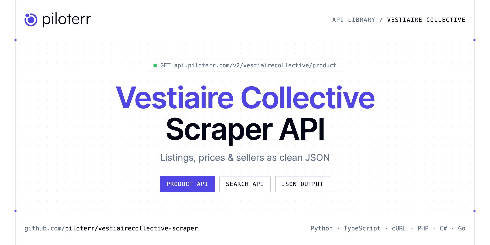

<p align="center">
  <a href="https://www.piloterr.com"></a>
</p>

# Vestiaire Collective Scraper API

[](https://discord.gg/CFj3ph8aHU) [](https://app.piloterr.com) [](https://app.piloterr.com/openapi) [](LICENSE)

The **Piloterr Vestiaire Collective Scraper API** lets you extract public data from Vestiaire Collective as **clean, structured JSON** — no proxies, headless browsers or HTML parsing to maintain. Endpoints available in production:

- **Vestiaire Collective Product API** — Fetch one Vestiaire Collective listing by product URL.
- **Vestiaire Collective Search API** — Search Vestiaire Collective by keyword or catalog URL.

Use it for listing monitoring, price benchmarks, stock sourcing or market analytics on second-hand and vehicle marketplaces.

| Endpoint | Path | Credits | What you get |
|---|---|---|---|
| [Vestiaire Collective Product API](#vestiaire-collective-product-api) | `/v2/vestiairecollective/product` | 2 | Fetch one Vestiaire Collective listing by product URL. The response is a flat object with price, size, condition, and seller. |
| [Vestiaire Collective Search API](#vestiaire-collective-search-api) | `/v2/vestiairecollective/search` | 2 | Search Vestiaire Collective by keyword or catalog URL. Each card has brand, name, price, size, and a product link. |

## Table of contents

- [How it works](#how-it-works)
- [Vestiaire Collective Product API](#vestiaire-collective-product-api)
- [Vestiaire Collective Search API](#vestiaire-collective-search-api)
- [Code examples in other languages](#code-examples-in-other-languages)
- [Practical use cases](#practical-use-cases)
- [Why Piloterr?](#why-piloterr)
- [FAQ](#faq)
- [Related scrapers](#related-scrapers)
- [Support](#support)

## How it works

1. **Create a free Piloterr account** and copy your API key from the [dashboard](https://app.piloterr.com).
2. **Send a `GET` (or `POST`) request** to `https://api.piloterr.com/v2/...` with the header `x-api-key: YOUR_API_KEY`.
3. **Receive structured JSON** — Piloterr handles rendering, proxies, retries and parsing.

```bash
export PILOTERR_API_KEY="your-api-key"
pip install requests        # Python
# TypeScript: Node.js 18+ (native fetch), run with `npx tsx file.ts`
```

> Every endpoint accepts both `GET` (query string) and `POST` (JSON body with the same fields).

## Vestiaire Collective Product API

Fetch one Vestiaire Collective listing by product URL. The response is a flat object with price, size, condition, and seller.

`GET | POST https://api.piloterr.com/v2/vestiairecollective/product` · **2 credits per request** · [Full reference](https://app.piloterr.com/openapi)

### Request parameters

| Parameter | Type | Required | Description |
|---|---|---|---|
| `query` | string | ✅ | A vestiairecollective.com product URL ending in the item id and .shtml. The response is one flat listing. price is the number on the page and price_display is that amount as written. A keyword or a search URL returns 400… |
| `return_page_source` | boolean | — | Default false. true replaces the listing with result, the rendered HTML. |

### Python example

```python
import json
import os
import requests

response = requests.get(
    "https://api.piloterr.com/v2/vestiairecollective/product",
    headers={"x-api-key": os.environ["PILOTERR_API_KEY"]},
    params={
        "query": "https://www.vestiairecollective.com/vetements-femme/vestes/chanel/vesteblouson-chanel-la-petite-veste-noire-en-tweed-rose-73024488.shtml",
    },
    timeout=120,
)
response.raise_for_status()
data = response.json()

print(json.dumps(data, indent=2, ensure_ascii=False)[:2000])
```

### TypeScript example

```typescript
type VestiaireCollectiveProduct = {
  id?: string;
  url?: string;
  name?: string;
  size?: string;
  sold?: boolean;
  brand?: string;
  color?: string;
  image?: string;
  model?: string;
  price?: number;
  category?: string;
  currency?: string;
  material?: string;
  universe?: string;
  available?: boolean;
  brand_url?: string;
  condition?: string;
  listed_at?: string;
  like_count?: number;
  negotiable?: boolean;
  ships_from?: string;
  description?: string;
  offer_count?: number;
  seller_name?: string;
  subcategory?: string;
  [key: string]: unknown;
};

const params = new URLSearchParams({
  "query": "https://www.vestiairecollective.com/vetements-femme/vestes/chanel/vesteblouson-chanel-la-petite-veste-noire-en-tweed-rose-73024488.shtml",
});

const response = await fetch(`https://api.piloterr.com/v2/vestiairecollective/product?${params}`, {
  headers: { "x-api-key": process.env.PILOTERR_API_KEY! },
});
if (!response.ok) throw new Error(`Piloterr error ${response.status}: ${await response.text()}`);

const data = (await response.json()) as VestiaireCollectiveProduct;

console.log(JSON.stringify(data, null, 2).slice(0, 2000));
```

<details>
<summary><b>POST variant</b></summary>

```http
POST https://api.piloterr.com/v2/vestiairecollective/product
x-api-key: YOUR_API_KEY
Content-Type: application/json

{"query": "https://www.vestiairecollective.com/vetements-femme/vestes/chanel/vesteblouson-chanel-la-petite-veste-noire-en-tweed-rose-73024488.shtml"}
```
</details>

### Output example

Example response from the API reference, abridged — real values depend on the page you scrape.

```json
{
  "id": "73024488",
  "url": "https://www.vestiairecollective.com/vetements-femme/vestes/chanel/vesteblouson-chanel-la-petite-veste-noire-en-tweed-rose-73024488.shtml",
  "name": "Blouson en tweed La Petite Veste Noire",
  "size": "34 FR",
  "sold": false,
  "brand": "Chanel",
  "color": "Rose",
  "image": "https://images.vestiairecollective.com/images/resized/w=1024,q=75,f=auto,/produit/73024488-1_2.jpg",
  "model": "La Petite Veste Noire",
  "price": 1315,
  "category": "Vestes",
  "currency": "EUR",
  "material": "Tweed",
  "universe": "Femme",
  "available": true,
  "brand_url": "https://www.vestiairecollective.com/chanel/",
  "condition": "Très bon état",
  "listed_at": "2026-10-30T12:00:51Z",
  "like_count": 14,
  "negotiable": true,
  "ships_from": "France",
  "description": "Veste pour femme Chanel La Petite Veste Noire en tweed rose. Très bon état. Taille 34 FR.",
  "offer_count": 3,
  "seller_name": "example",
  "subcategory": "Blouson"
}
```

### Response fields

| Field | Type | Description |
|---|---|---|
| `id` | string |  |
| `url` | string |  |
| `name` | string |  |
| `size` | string |  |
| `sold` | boolean |  |
| `brand` | string |  |
| `color` | string |  |
| `image` | string |  |
| `model` | string |  |
| `price` | integer |  |
| `category` | string |  |
| `currency` | string |  |
| `material` | string |  |
| `universe` | string |  |
| `available` | boolean |  |
| `brand_url` | string |  |
| `condition` | string |  |
| `listed_at` | string |  |
| `like_count` | integer |  |
| `negotiable` | boolean |  |
| `ships_from` | string |  |
| `description` | string |  |
| `offer_count` | integer |  |
| `seller_name` | string |  |
| `subcategory` | string |  |

## Vestiaire Collective Search API

Search Vestiaire Collective by keyword or catalog URL. Each card has brand, name, price, size, and a product link.

`GET | POST https://api.piloterr.com/v2/vestiairecollective/search` · **2 credits per request** · [Full reference](https://app.piloterr.com/openapi)

### Request parameters

| Parameter | Type | Required | Description |
|---|---|---|---|
| `query` | string | ✅ | A keyword or a vestiairecollective.com search or category URL. Empty, another host, or a product URL returns 400. A keyword searches www.vestiairecollective.com. A full URL keeps its host. Each card has price as a number… |
| `page` | number | — | Page number starting at 1. Omit it for page 1, which has no /p-N/ segment. Page 2 requests /p-2/ and sets pagination.page to 2. pagination.next is the next catalog URL, or null on the last page. A value below 1 returns 4… |
| `return_page_source` | boolean | — | Default false. true replaces results and pagination with result, the rendered HTML. |

### Python example

```python
import json
import os
import requests

response = requests.get(
    "https://api.piloterr.com/v2/vestiairecollective/search",
    headers={"x-api-key": os.environ["PILOTERR_API_KEY"]},
    params={
        "query": "chanel",
    },
    timeout=120,
)
response.raise_for_status()
data = response.json()

print(json.dumps(data, indent=2, ensure_ascii=False)[:2000])
```

### TypeScript example

```typescript
type VestiaireCollectiveSearch = {
  results?: {
    id?: string;
    url?: string;
    name?: string;
    size?: string;
    brand?: string;
    image?: string;
    price?: number;
    currency?: string;
    ships_from?: string;
    price_display?: string;
  }[];
  pagination?: {
    next?: string;
    page?: number;
    per_page?: number;
    total_pages?: unknown;
    total_results?: number;
  };
};

const params = new URLSearchParams({
  "query": "chanel",
});

const response = await fetch(`https://api.piloterr.com/v2/vestiairecollective/search?${params}`, {
  headers: { "x-api-key": process.env.PILOTERR_API_KEY! },
});
if (!response.ok) throw new Error(`Piloterr error ${response.status}: ${await response.text()}`);

const data = (await response.json()) as VestiaireCollectiveSearch;

console.log(JSON.stringify(data, null, 2).slice(0, 2000));
```

<details>
<summary><b>POST variant</b></summary>

```http
POST https://api.piloterr.com/v2/vestiairecollective/search
x-api-key: YOUR_API_KEY
Content-Type: application/json

{"query": "chanel"}
```
</details>

### Output example

Example response from the API reference, abridged — real values depend on the page you scrape.

```json
{
  "results": [
    {
      "id": "73024488",
      "url": "https://www.vestiairecollective.com/vetements-femme/vestes/chanel/vesteblouson-chanel-la-petite-veste-noire-en-tweed-rose-73024488.shtml",
      "name": "Blouson en tweed La Petite Veste Noire",
      "size": "34 FR",
      "brand": "CHANEL",
      "image": "https://images.vestiairecollective.com/images/resized/w=768,q=75,f=auto,/produit/vesteblouson-chanel-la-petite-veste-noire-en-tweed-rose-…",
      "price": 1315,
      "currency": "EUR",
      "ships_from": "France",
      "price_display": "1315 €"
    }
  ],
  "pagination": {
    "next": "https://www.vestiairecollective.com/search/p-2/?q=chanel",
    "page": 1,
    "per_page": 15,
    "total_pages": null,
    "total_results": 999
  }
}
```

### Response fields

| Field | Type | Description |
|---|---|---|
| `results[]` | object[] |  |
| `results[].id` | string |  |
| `results[].url` | string |  |
| `results[].name` | string |  |
| `results[].size` | string |  |
| `results[].brand` | string |  |
| `results[].image` | string |  |
| `results[].price` | integer |  |
| `results[].currency` | string |  |
| `results[].ships_from` | string |  |
| `results[].price_display` | string |  |
| `pagination` | object |  |
| `pagination.next` | string |  |
| `pagination.page` | integer |  |
| `pagination.per_page` | integer |  |
| `pagination.total_pages` | object |  |
| `pagination.total_results` | integer |  |

## Code examples in other languages

Ready-to-run examples live in the [`examples/`](examples) folder. Each one reads your key from the `PILOTERR_API_KEY` environment variable.

| Language | Product | Search |
|---|---|---|
| cURL (Bash) | [`product`](examples/curl/product.sh) | [`search`](examples/curl/search.sh) |
| PHP | [`product`](examples/php/product.php) | [`search`](examples/php/search.php) |
| C# | [`product`](examples/csharp/Product.cs) | [`search`](examples/csharp/Search.cs) |
| Go | [`product`](examples/go/product.go) | [`search`](examples/go/search.go) |
| Java | [`product`](examples/java/ProductExample.java) | [`search`](examples/java/SearchExample.java) |
| Ruby | [`product`](examples/ruby/product.rb) | [`search`](examples/ruby/search.rb) |
| Node.js | [`product`](examples/nodejs/product.mjs) | [`search`](examples/nodejs/search.mjs) |

## Practical use cases

- **Listing monitoring** — Get alerted when new ads matching your criteria are published.
- **Price benchmarks** — Compute market prices per model, category or location.
- **Sourcing** — Find stock, vehicles, parts or equipment faster than manual browsing.
- **Market analytics** — Measure supply, turnover and pricing trends over time.
- **Data products** — Feed valuation models and dashboards with structured listings.

## Why Piloterr?

- **No infrastructure** — no proxies, headless browsers or CAPTCHA solving to run yourself.
- **Structured JSON** — stable, documented fields instead of brittle HTML selectors.
- **Pay per request** — transparent credit cost per endpoint, failed requests are retried for you.
- **One API key, hundreds of sources** — Vestiaire Collective plus many other e-commerce, search and company data endpoints in the [Piloterr library](https://www.piloterr.com/library).
- **Any language** — plain HTTPS + JSON, with examples for Python, TypeScript, cURL, PHP, C#, Go, Java, Ruby and Node.js.

## FAQ

### Is it legal to scrape Vestiaire Collective?

Collecting publicly available data is generally allowed in many jurisdictions, but rules depend on your country, the data you collect and how you use it. Avoid personal data unless you have a lawful basis, respect the website's terms where they apply, and get legal advice for your specific use case. This is not legal advice.

### Do I need proxies or a headless browser?

No. Piloterr handles rendering, proxy rotation and retries on its side. You only send an HTTPS request with your `x-api-key` header and receive JSON.

### How much does a request cost?

Credits per call: `/v2/vestiairecollective/product` **2**, `/v2/vestiairecollective/search` **2**. See the [Piloterr website](https://www.piloterr.com) for plans.

### What data does the Vestiaire Collective API return?

Each endpoint returns structured JSON: **Vestiaire Collective Product** — `id`, `url`, `name`, `size`, `sold`, `brand`; **Vestiaire Collective Search** — `results[]`, `results[].id`, `results[].url`, `results[].name`, `results[].size`, `results[].brand`.

### How do I paginate Vestiaire Collective results?

Use the `page` parameter and keep requesting while the response indicates more results.

### Can I get the raw HTML instead of JSON?

Yes. Set `return_page_source=true` and the response becomes `{"result": "..."}` with the page source.

### Which languages are supported?

Any language that can make an HTTP request. This README shows Python and TypeScript; the [`examples/`](examples) folder contains cURL, PHP, C#, Go, Java, Ruby and Node.js.

## Related scrapers

- [AutoScout24 Scraper API](https://github.com/piloterr/autoscout24-scraper)
- [Autotrader Scraper API](https://github.com/piloterr/autotrader-scraper)
- [Copart Scraper API](https://github.com/piloterr/copart-scraper)
- [Kijiji Scraper API](https://github.com/piloterr/kijiji-scraper)
- [Leboncoin Scraper API](https://github.com/piloterr/leboncoin-scraper)
- [Mascus Scraper API](https://github.com/piloterr/mascus-scraper)
- [All Piloterr scrapers on GitHub](https://github.com/piloterr)

## Support

- 💬 Join the [Piloterr Discord](https://discord.gg/CFj3ph8aHU) to ask questions and share what you build.
- 📚 Browse the [API reference (OpenAPI)](https://app.piloterr.com/openapi) and the [Piloterr library](https://www.piloterr.com/library).
- 🔑 [Get your API key](https://app.piloterr.com).

---

<p align="center">
  <a href="https://www.piloterr.com">
    <picture>
      <source media="(prefers-color-scheme: dark)" srcset="images/logo-dark.svg">
      
    </picture>
  </a>
  <br>
  <sub>Built by <a href="https://www.piloterr.com">Piloterr</a> — web scraping APIs for e-commerce, search, real estate and more, one API key.</sub>
</p>

<sub>Vestiaire Collective is a trademark of its respective owner. This repository is not affiliated with or endorsed by Vestiaire Collective. Examples are released under the MIT license.</sub>
